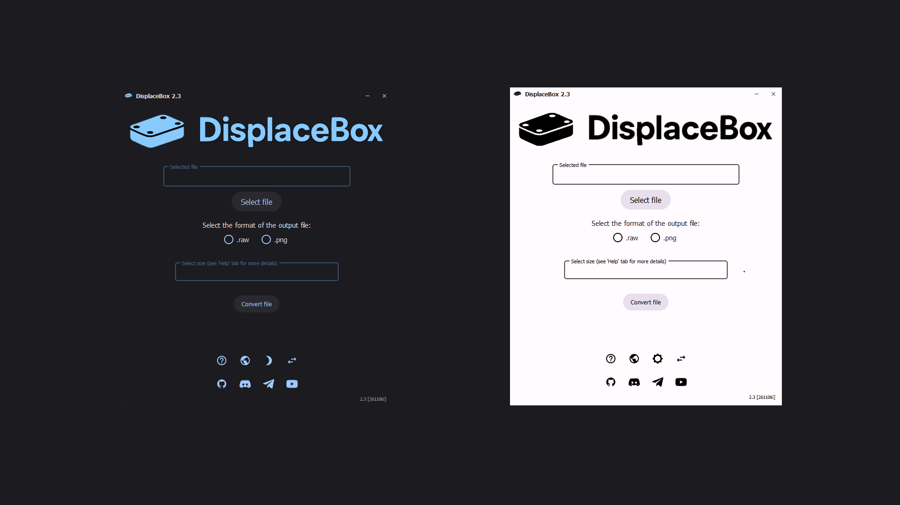
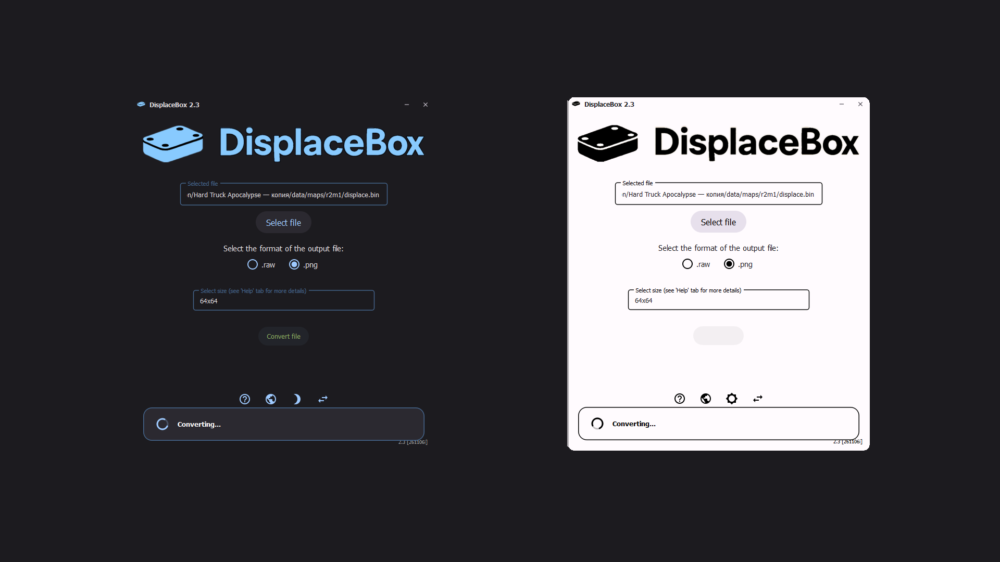
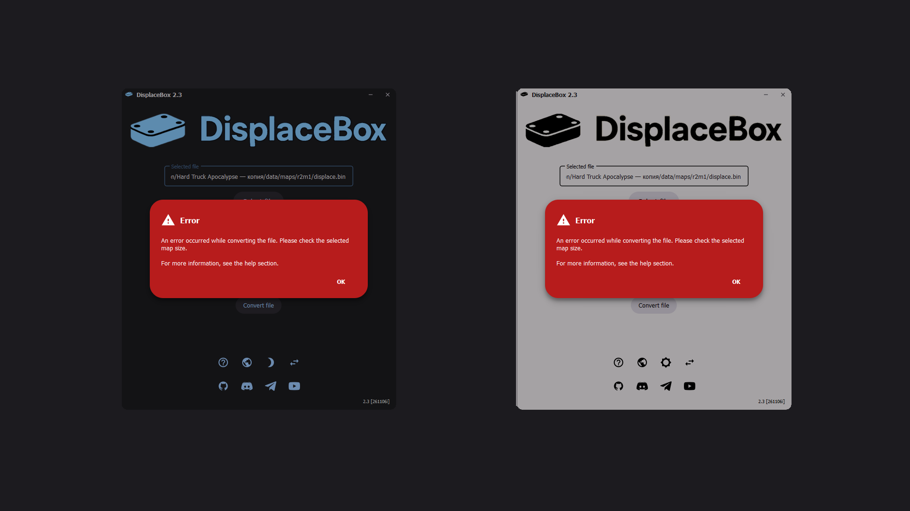
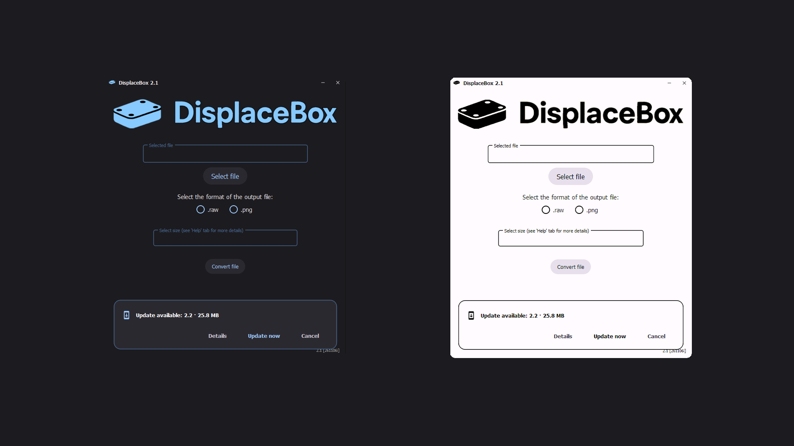

# DisplaceBox


This program helps you convert your map's `displace.bin` files into `.raw` or `.png` formats, and back. It is designed to simplify the conversion process.

powered by [Python](https://github.com/python/cpython) & [PyQt6](https://www.riverbankcomputing.com/software/pyqt/)

## Table of Contents

- [Features](#features)
- [How to Use](#how-to-use)
- [Screenshots](#screenshots)
- [Download](#download)
- [Requirements](#requirements)
- [Installation](#installation)
- [Run from Source](#run-from-source)
- [Editing Heightmaps](#editing-heightmaps)
- [License](#license)
- [Authors](#authors)

## Features

- **File Selection**: Choose the `displace.bin` file from your map folder.
- **Format Selection**: Choose the output file format (`.raw` or `.png`).
- **Auto Size Detection**: The program automatically reads the `LEVELSIZE` parameter from the map's `.ssl` file. Manual selection remains as a fallback.
- **Conversion**: Convert the selected file to the desired format and size.
- **Reverse Conversion**: Convert `.raw` or `.png` files back to `.bin` using the JSON metadata file.
- **Height Range Extension**: In the reverse converter, expand the min/max height range using sliders, allowing you to draw mountains higher than the original map maximum. The hard limit is read from `MAXHEIGHT` in the `.ssl` file.
- **Smart Terrain Restore**: When reverse converting, the program preserves original heights of untouched pixels — changes only apply to the area you edited.
- **Settings Persistence**: Language, theme, and last opened folder are saved to `settings.json` in `%LOCALAPPDATA%/DisplaceBox/`.
- **Help Section**: Provides detailed instructions and information about the program.
- **Multi-language Support**: The program supports the following languages — Russian, English, Ukrainian, Belarusian, and Polish.

**IMPORTANT**: Ukrainian and Polish localizations have an "unverified" status and may contain errors. If you find any mistakes in the translation, please create an issue or a merge request.

## How to Use

### Forward conversion (`.bin` → `.raw` / `.png`)

1. **Select File**: Click the "Select File" button to choose the `displace.bin` file from your map folder.
2. **Select Format**: Choose the output file format (`.raw` or `.png`).
3. **Select Size**: The size is auto-detected from the `.ssl` file. If it fails, choose the size manually.
4. **Convert File**: Click the "Convert File" button to start the conversion process.
5. **View Result**: If the conversion is successful, you will see a success message, and the converted file will appear in the folder along with a JSON metadata file.

### Reverse conversion (`.raw` / `.png` → `.bin`)

1. **Select File**: Choose the `.raw` or `.png` file you edited.
2. **Select JSON**: Choose the `displace_<mapname>_metadata.json` file created during forward conversion.
3. **Adjust Range** (optional): Click "Edit" next to the current range to expand min/max heights via sliders.
4. **Convert File**: Click "Convert File". The output `displace.bin` will be saved next to the source file.

## Screenshots

<div align="center">
  






</div>

## Download

**You can download the compiled file here:** https://github.com/stakanyash/displacebin_gui_converter/releases

> [!WARNING]
> The DisplaceBox executable may trigger false positives in some antivirus software. This is a known issue with Python applications compiled into `.exe` files.
>
> DisplaceBox does **not** contain any malicious code. The application only processes local files, performs format conversions, checks for updates, and downloads update packages from the official GitHub repository.
>
> If your antivirus software flags the executable, you may need to add it to the exceptions list.

## Requirements

- Python 3.12 or newer (3.14 supported)
- PyQt6
- Pillow (PIL)
- requests
- packaging

Dependencies are managed via `pyproject.toml` and [`uv`](https://github.com/astral-sh/uv).

## Installation

1. Clone the repository:
   ```bash
   git clone https://github.com/stakanyash/displacebin_gui_converter.git
   ```

2. Navigate to the project directory:
   ```bash
   cd displacebin_gui_converter/src
   ```

3. Install [uv](https://docs.astral.sh/uv/getting-started/installation/) if you haven't already.

4. Install dependencies:
   ```bash
   uv sync
   ```

This will create a virtual environment (`.venv`) and install all required packages, including dev dependencies like Nuitka.

## Run from Source

To run the program, execute the following command:

```bash
uv run main.py
```

## Building the Executable

The project is compiled using [Nuitka](https://nuitka.net/). Build script is provided in `build_onefile.ps1`:

```powershell
.\build_onefile.ps1
```

> [!NOTE]
> If PowerShell blocks the script due to execution policy, either run it with `powershell -ExecutionPolicy Bypass -File .\build_onefile.ps1` or set the policy once with `Set-ExecutionPolicy -ExecutionPolicy RemoteSigned -Scope CurrentUser`.

## Editing Heightmaps

The `.png` output is **16-bit grayscale** (65,536 levels). Not all image editors handle this format correctly. Choose your tool carefully:

| Editor | 16-bit Grayscale | Notes |
|--------|------------------|-------|
| **GIMP** | ✅ Yes | Recommended. Use `Image → Mode → Grayscale` and `Image → Precision → 16-bit integer`. When exporting, uncheck "Save color profile" and "Save gamma". |
| **Krita** | ⚠️ Yes, with caveats | Make sure to use `Gray/Alpha` (NOT `Gray/Alpha` with alpha), non-linear color space, and disable color management to avoid sRGB distortion. |
| **Photoshop** | ⚠️ Yes, with caveats | Applies sRGB profile by default. Use `Edit → Assign Profile → Don't Color Manage This Document` before saving. |
| **Paint.NET** | ❌ No | Silently downgrades to 8-bit. Will lose 99% of height precision. |
| **Aseprite** | ❌ No | 8-bit only. |

> [!IMPORTANT]
> If you edit a 16-bit grayscale PNG in an editor that applies sRGB color profile (Photoshop, Krita by default, Paint.NET), the pixel values will be transformed non-linearly, and Smart Restore may consider untouched pixels as "changed". Always check the conversion log for `SMART RESTORE` stats.

## License

This project is licensed under the MIT License. See the [LICENSE](LICENSE) file for details.

## Authors

* **Program Author**: stakan
* **Conversion Script Author**: [ThePlain](https://github.com/ThePlain)
